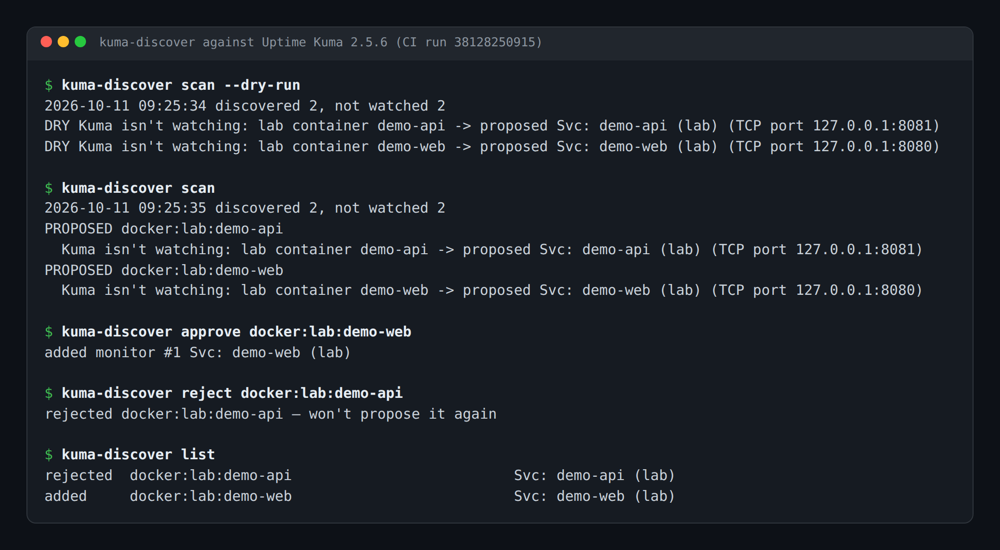
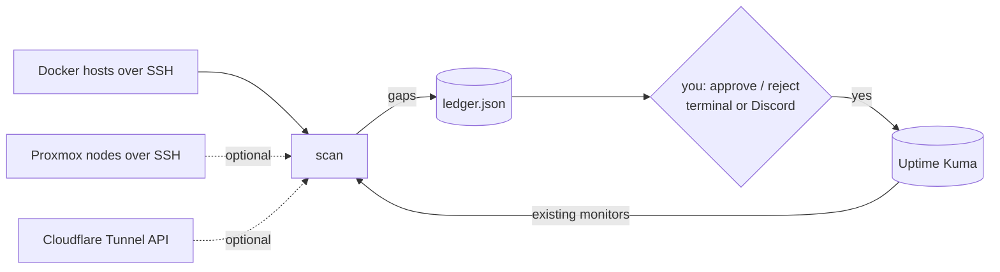

# kuma-discover

Finds the services Uptime Kuma isn't watching on your Docker hosts (and optionally Proxmox and Cloudflare Tunnel), and adds a monitor only after you say yes.



*Real output from the CI setup check: a real Uptime Kuma 2.5.6 container and real nginx containers on a GitHub runner.*

  [](https://buymeacoffee.com/iamc_tech)

## Contents

- [What it does](#what-it-does)
- [Quick start](#quick-start)
- [Usage](#usage)
- [Configuration](#configuration)
- [How it works](#how-it-works)
- [Status, limits and real results](#status-limits-and-real-results)
- [Licence and credits](#licence-and-credits)

## What it does

- **Finds Docker containers with published ports** on any number of hosts over SSH (or locally), skipping loopback-only ports and Kuma itself (matched by image, so it works whatever you named the container).
- **Optionally finds Proxmox LXC containers** (ping monitors) and **Cloudflare Tunnel public hostnames** (HTTPS monitors), read-only.
- **Works out what's already covered**: same IP, same host and port, same hostname, a monitored tunnel hostname in front of the container, or a monitor with the same name.
- **Asks before adding anything**, either at the terminal (`review`, `approve`, `reject`) or with ✅ / ❌ reactions in a Discord channel, where only the owner's reaction counts.
- **Remembers every decision.** A rejected service is never proposed again, and nothing pending is asked twice.
- **Reads every new monitor back from Kuma** before saying it's added.
- **Works with Kuma 1.23 and 2.x**, including the Kuma 2 change that breaks `uptime-kuma-api`'s own add call.

## Quick start

You need Python 3.11+, Uptime Kuma 1.23 or 2.x, and SSH key login to a Docker host whose user can run `docker` without sudo.

```bash
pipx install git+https://github.com/casareanderson/kuma-discover
curl -fsSLO https://raw.githubusercontent.com/casareanderson/kuma-discover/main/config.example.toml
mv config.example.toml kuma-discover.toml        # then set [kuma] url and your [[docker_hosts]]
export KUMA_USERNAME=admin KUMA_PASSWORD='your-kuma-password'
kuma-discover scan --dry-run
```

Success looks like one `DRY Kuma isn't watching: …` line per unwatched service, and nothing changed in Kuma. The full walkthrough, including Proxmox, Cloudflare, Discord and the common errors, is in [docs/SETUP.md](docs/SETUP.md).

## Usage

```bash
kuma-discover scan                     # record proposals as pending (posts them to Discord if enabled)
kuma-discover review                   # y / n / skip each pending proposal
kuma-discover approve docker:nas:immich
kuma-discover reject docker:nas:scratch
kuma-discover list                     # every proposal and what happened to it
kuma-discover poll                     # Discord mode: act on the owner's reactions
```

Run `scan` daily from cron or a systemd timer. It only proposes, so it's safe to run unattended.

## Configuration

A TOML file (`--config`, `$KUMA_DISCOVER_CONFIG`, or `./kuma-discover.toml`); the template is [config.example.toml](config.example.toml). Secrets only come from the environment.

| Setting | Default | What it does |
|---|---|---|
| `[kuma] url` | `http://127.0.0.1:3001` | Kuma web address |
| `[kuma] notification_ids` | `[]` | Kuma notifications new monitors alert to |
| `[kuma] interval` | `60` | Check interval (seconds) for new monitors |
| `[scan] max_new` | `6` | Proposals per run; the rest wait |
| `[scan] skip_containers` | `["uptime-kuma"]` | Container names never proposed |
| `[scan] skip_images` | `["louislam/uptime-kuma"]` | Image prefixes never proposed (Kuma itself, whatever it's called) |
| `[scan] expiry_days` | `14` | Discord proposals expire after this |
| `[scan] state_dir` | `~/.local/state/kuma-discover` | Where the decision ledger lives |
| `[[docker_hosts]]` | none | `name`, `ssh` (`user@host` or `local`), `address` |
| `[[proxmox_nodes]]` | none | `ssh` (`root@node`), optional `ip_prefix` |
| `[cloudflare]` | off | `enabled`, `account_id` |
| `[discord]` | off | `enabled`, `channel_id`, `owner_id` |
| `KUMA_USERNAME`, `KUMA_PASSWORD` | required | Kuma login |
| `CF_API_TOKEN` | | Cloudflare token with Account → Cloudflare Tunnel → Read |
| `DISCORD_BOT_TOKEN` | | Bot that can post and react in the channel |

## How it works



Discovery is plain commands: `docker ps` over SSH, a short `pct` script sent over SSH stdin for Proxmox, and two GET calls per tunnel for Cloudflare. A source that fails is logged and skipped, so one box being down doesn't stop the scan. There's no AI model anywhere; every decision is a rule you can read in `core.py`.

```
kuma_discover/
  core.py      discovery sources, coverage rules, ledger
  kuma.py      Kuma login (with retry), add + read-back, Kuma 2 workaround
  discord.py   optional ✅ / ❌ approvals
  cli.py       scan / review / approve / reject / poll / list
tests/         14 tests with SSH, Kuma and Discord mocked
scripts/
  setup-check.sh  what CI runs to prove docs/SETUP.md works
```

## Status, limits and real results

- **Status:** this is the cleaned-up, configurable copy of a script that has run daily in a homelab since 7 Oct 2026, when Uptime Kuma moved hosts and it turned out nothing had ever added monitors automatically. Its first run found 18 services and proposed 5. All 5 were approved and added.
- **Tested:** 14 unit tests, plus a CI setup check against real Kuma **1.23.16** and **2.5.6-slim** containers that follows [docs/SETUP.md](docs/SETUP.md) from install to an approved monitor appearing in Kuma.
- **Kuma 2 compatibility** relies on a workaround (`kuma.py`) because `uptime-kuma-api` 1.2.1 predates Kuma 2. A future Kuma release could need another one.
- **Login can time out** on a busy Kuma (2 in 7 runs once, against a Kuma on a small NAS). It retries 3 times.
- **Proxmox, Cloudflare and Discord paths** run in that homelab but aren't CI-tested.
- **It doesn't remove monitors.** If a service goes away, its monitor stays until you delete it.
- **Port checks only for Docker.** It can't tell which containers serve HTTP, so it adds a TCP port monitor. Change it to HTTP in Kuma if you want status codes checked.

## Licence and credits

MIT, see [LICENSE](LICENSE). Uses [uptime-kuma-api](https://github.com/lucasheld/uptime-kuma-api) (MIT) to talk to [Uptime Kuma](https://github.com/louislam/uptime-kuma) (MIT).

If kuma-discover is useful to you, [buy me a coffee](https://buymeacoffee.com/iamc_tech). More field notes at [dev.to/iam-tech](https://dev.to/iam-tech).
